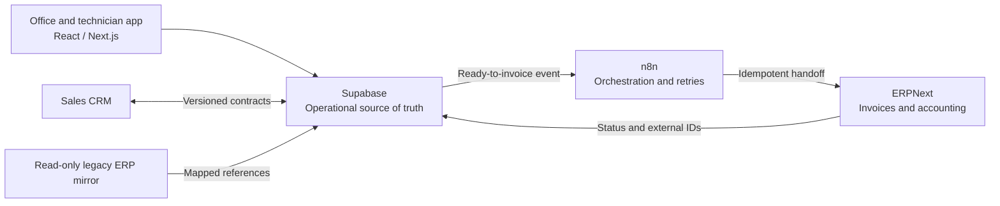

# Technical assessment

## Objective and starting point

Deliver an internal business platform in accepted, independently priced modules while keeping the
existing operational application running. The brief describes approximately 30 staff, a
React/TypeScript/Supabase office application, a separate Sales CRM, self-hosted n8n, a read-only
legacy ERP mirror and a separate ERPNext implementation.

The existing system and the payroll defect specification have not been supplied for this assessment.
The architecture below is a proposal based on the brief. The implementation in this repository is a
new, isolated payroll sample with synthetic data, not a migration plan for an inspected client
database.

## Ownership and integration boundaries

| Area               | Proposed responsibility                                | Boundary                                                        |
| ------------------ | ------------------------------------------------------ | --------------------------------------------------------------- |
| Office application | Operational workflow, approval and readiness           | Owns work up to ready to invoice                                |
| Supabase           | Operational records, identity, access, invariants      | Migrations and function changes through Git review              |
| Sales CRM          | Sales activity until an agreed handoff                 | Coordinate ownership before creating or merging shared entities |
| n8n                | Automation, delivery and retries                       | Does not become a second master of business rules               |
| ERPNext            | Invoice numbering, issuing, accounting and receivables | Confirm exact API and status contract with its owner            |
| Legacy mirror      | Historical lookup and migration source                 | No write-back; preserve original external identifiers           |

Propose a transactional outbox for the ready-to-invoice handoff: snapshot the accepted payload and
version in the same transaction as the operational transition. A worker delivers it with a stable
idempotency key, tracks external IDs and reconciles failures. ERPNext integration behavior,
duplicate prevention and retries must be proved against the agreed ERPNext interface. None of these
integrations is implemented in the payroll sample.

## Shared domain model

The requested chain is a useful business vocabulary, but its cardinalities need agreement before a
migration. In particular, a property is a service location; an invoice recipient is a billing party
and may differ from the customer. Avoid encoding that distinction as duplicated customer records.

| Entity                 | Proposed definition and invariant                                                                     |
| ---------------------- | ----------------------------------------------------------------------------------------------------- |
| Customer               | Commercial account with stable identity and mapped legacy identifiers                                 |
| Object                 | Physical service location belonging to a customer; address history must be explicit                   |
| Invoice recipient      | Billing party; link to eligible customers/objects instead of assuming a single recipient per property |
| Project                | Operational grouping of work; reference customer and object, with agreed billing rules                |
| Quote / quote position | Versioned offer and priced scope; acceptance converts a specific revision                             |
| Order / order position | Accepted work and quantities; retain source quote links and auditable changes                         |
| Tour / assignment      | Planned work for a crew and time window; distinguish planning from actual work                        |
| Job completion         | Technician evidence: completed quantities, extra work, timestamps and private photos                  |
| Billing preparation    | Reviewed, versioned snapshot eligible for ERPNext handoff                                             |

Use explicit foreign keys and server-side invariants to keep an order, its object and its customer
consistent. Historical prices, tax-related classifications and billing addresses should be
snapshotted at the agreed business event. Agree cancellation, partial completion, credit and
correction behavior before locking a fixed price.

The sample uses organization-scoped payroll tables to make isolation testable. This is an
authorization example, not a recommendation to add multitenancy to a single-company application. The
shared operational model above is design work, not an implemented schema in this repository.

## Module 1: acceptance-led payroll correction

1. Obtain the approximately 11 specified defects, their expected values, the current exporter, the
   import format and the corrected reference-month file through private access.
2. Document each rule: source field, selection period, sign, rounding, inclusion, booking month,
   output column and approved expected result.
3. Turn the corrected file into a protected golden fixture, with minimized or synthetic records
   wherever possible. Preserve any encoding, ordering and line-ending requirements.
4. Add a failing regression for each defect before changing its behavior. Patch the existing
   exporter with the smallest supported change.
5. Compare the complete output byte for byte; show a row/column diff on failure without logging
   sensitive values in public CI.
6. Run role and period regressions and obtain written acceptance on the reference export without
   manual correction.

The original sample exercises compensation, deduction signs, negative bonuses, source mini-job
amounts, separate earning/booking months, subcontractor exclusion, approval filtering and
deterministic output. It does **not** claim to reproduce all 11 errors. It defines an illustrative
CSV and one record per employee per earning month. Actual wage types, corrections across periods,
multiple records, statutory rules and the target payroll importer must follow the supplied
specification.

## Access and data protection

| Role                  | Implemented sample access                       | Proposed operational access, subject to specification         |
| --------------------- | ----------------------------------------------- | ------------------------------------------------------------- |
| Administrator         | Own organization payroll export and reads       | Configuration and explicit privileged workflows               |
| Payroll officer       | Own organization payroll export and reads       | Payroll review/export only as agreed                          |
| Dispatcher            | No payroll rows or exports                      | Planning, tours and operational job status                    |
| Technician            | Own employee record; no payroll rows or exports | Assigned work, job completion, extra-work evidence and photos |
| Anonymous / nonmember | No business data or exports                     | No business data                                              |

Membership is authoritative in a database table. Browser users cannot create memberships, change
their roles or mutate payroll records. The export RPC runs with caller privileges and RLS; a
narrowly scoped definer helper checks membership. Revoking membership denies the next export even if
a token has not expired. The real application should separately define provisioning, approval
transitions and audit retention; this read-only sample does not implement them.

For later photo handling, use private Storage buckets, assignment-aware policies and short-lived
access URLs. Agree retention, deletion, access logging, region and processing terms with the client
before handling real employee or customer records. These are requirements to resolve, not controls
demonstrated by the sample.

## Team shape and coordination

Planning assumes one lead architect at **10–12 hours/week** and **two developers at 32–36 hours/week
each**. These are proposed allocations, not claims about named people or their availability.

The architect owns the model, interface contracts and ADRs, reviews every PR, coordinates in writing
with the CRM/n8n/ERPNext owners and sends a weekly status. Developer A starts payroll, then
quotes/orders. Developer B prepares isolated shared-model work, then dispatch/technician completion.
Shared-model decisions precede dependent implementation; the two work streams converge for
office/billing workflows.

Use the client's shared Claude projects by area. End each working day with: **decided / done / open
/ affects others**, including links to the relevant PRs and contract versions. Record durable
decisions in Git so the shared project is context rather than the only source of truth. Use written
English throughout; no call or video dependency.

## Delivery and acceptance gates

- Each module starts with a written spec, explicit exclusions, dependencies and measurable
  acceptance criteria. Quote a fixed price only after these are accepted.
- All implementation, migrations and Edge Functions live in the client's GitHub and Supabase
  organization. Small PRs, architect review and CI precede deployment; no direct production edits.
- Use a separate staging environment and synthetic fixtures. Apply migrations from Git, rehearse
  data changes and establish a recovery plan before release.
- Module 2 accepts a domain dictionary, ownership matrix, constrained schema and legacy mapping.
  Module 3 accepts agreed quote/order lifecycle scenarios. Module 4 accepts conflict handling and
  technician evidence flows. Module 5 accepts reconciliation and agreed ERPNext handoff behavior.
- The later CRM merge is a separate scope. ERPNext setup and n8n ownership remain with their
  existing owners unless explicitly reassigned.

See [estimates](estimates.md) for effort, assumptions and dependencies and
[AI workflow](ai-workflow.md) for the proposed review/test discipline.

## Information needed before commitment

For engineering: detailed payroll spec/reference file; current schema/RLS/functions; existing tests;
payroll import requirements; ownership contracts with CRM/n8n/ERPNext; and acceptance owners for
each module.

For the agency application: two approved live business-app links with builder attribution and
roles/permissions evidence; named architect and two developers with Upwork links, rates, time zones
and weekly availability; two contactable references with permission; and the current contract count.
These facts are not established by a public sample and should be supplied privately by the agency.

## Platform references

Implementation choices were checked against primary documentation for
[Supabase function authentication](https://supabase.com/docs/guides/functions/auth),
[caller identity validation](https://supabase.com/docs/reference/javascript/auth-getuser),
[RLS](https://supabase.com/docs/guides/database/postgres/row-level-security) and
[Next.js static exports](https://nextjs.org/docs/app/guides/static-exports). They support the
mechanisms used here; the proposed business architecture is our assessment of the supplied brief.
